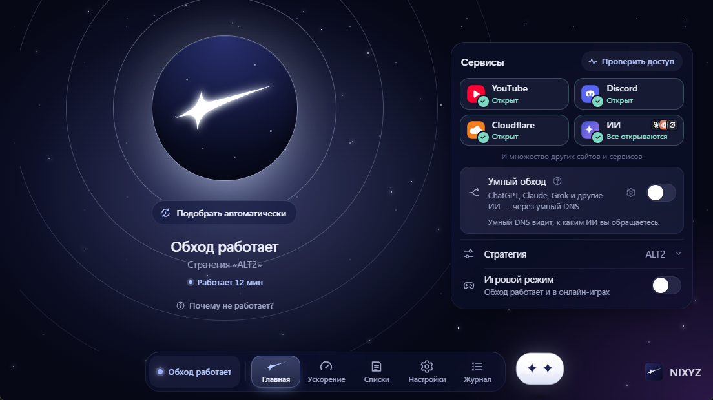

<p align="center"></p>

<h1 align="center">NIXYZ</h1>

<p align="center">Восстанавливает соединение с YouTube и Discord одной кнопкой. Для Windows 10 и 11.</p>

<p align="center">
  <a href="https://github.com/Yonswi/NIXYZ/releases/latest/download/NIXYZ-Setup.exe"></a>
  <a href="https://github.com/Yonswi/NIXYZ/releases/latest"></a>
  <a href="LICENSE"></a>
</p>

<p align="center"></p>

<p align="center"><sub>The program also has an English interface. See the <a href="TERMS.en.md">Terms of Use</a> and <a href="PRIVACY.en.md">Privacy Policy</a>.</sub></p>

## Установка

**[Скачайте `NIXYZ-Setup.exe`](https://github.com/Yonswi/NIXYZ/releases/latest/download/NIXYZ-Setup.exe) и запустите его.** Примите соглашение и в запросе Windows нажмите «Да».
Больше ничего делать не нужно:

- NIXYZ установится в `C:\Program Files\NIXYZ`, создаст ярлыки в «Пуске» и на рабочем столе
  и появится в «Параметры → Приложения»;
- скачает движок с GitHub и сверит его контрольную сумму;
- сам подберёт настройку, при которой открываются YouTube и Discord, и включит обход.

Дальше обход включается и выключается большой кнопкой. Крестик прячет окно в трей (значок у часов),
а обход продолжает работать. Чтобы выйти совсем, нажмите правой кнопкой по значку и выберите «Выйти».

Язык — русский или английский: по умолчанию выбирается по региону Windows (русский для стран СНГ),
сменить можно в настройках. Там же светлая и тёмная тема.

SHA-256 установщика: `0430c626ce7469a14a706078214df8307a7885cf44e16ab94880154d12f0484e`

## Ускорение интернета

Раздел «Ускорение» на нижней панели. Скорость выше тарифа не станет, такого не умеет ни одна программа.
NIXYZ убирает только то, что эту скорость тормозит, и делает это встроенными средствами Windows:

- **Быстрый DNS.** Замеряет, как быстро отвечают DNS провайдера, Cloudflare (1.1.1.1), Google (8.8.8.8)
  и Quad9 (9.9.9.9). Другой DNS ставит, только если он заметно быстрее вашего. Можно выбрать и вручную.
- **Wi-Fi без энергосбережения.** Адаптер не засыпает, поэтому меньше задержек и обрывов, особенно на ноутбуке.
- **Автонастройка TCP.** Если её кто-то выключил, NIXYZ включит её обратно (обычный режим Windows).
- **Очистка кэша DNS.**
- **Замер скорости** по трём источникам: Cloudflare, Яндекс Интернетометр и Selectel. С каждого скачивается
  до 25 МБ, общая скорость — среднее. Запускается только по кнопке.

Перед любым изменением NIXYZ запоминает, как было. «Вернуть как было» и удаление программы
(и из настроек, и через «Приложения») ставят прежние настройки обратно. Это же делает строка «Вернуть всё как было» внизу экрана.

Для работы стратегий NIXYZ при первом запуске включает TCP timestamps, как и `service.bat` из zapret. Если они были выключены, прежнее значение вернётся при удалении программы, а если вы пользовались «Ускорением», то и кнопкой возврата (когда обход выключен).

## Умный обход

Для ИИ-сервисов, недоступных в некоторых регионах: ChatGPT и Sora, Claude, Grok, DeepL, ElevenLabs, OpenRouter, Cursor.
DNS-запросы только к этим сервисам уходят на сторонний умный DNS (`dns.comss.one`, запасной `geohide.ru`), а сами соединения с ними идут через его прокси.
Содержимое остаётся зашифрованным, но владелец этого DNS-сервера видит, когда и откуда вы к ним обращаетесь. Остальной трафик и DNS не меняются.
Можно указать свой сервер в настройках. Выключен по умолчанию.

Он включается отдельно от главной кнопки и работает, даже когда обход выключен. Если NIXYZ аварийно закроется или компьютер потеряет питание, ИИ-сервисы не будут открываться, пока NIXYZ не запустится снова: при запуске он сам снимает старое правило.

Условия некоторых ИИ-сервисов ограничивают работу из неподдерживаемых стран, аккаунт могут заблокировать ([OpenAI](https://help.openai.com/en/articles/9131992-chatgpt-and-api-services-in-unsupported-countries-and-territories), [Anthropic](https://www.anthropic.com/supported-countries)). При первом включении программа напомнит об этом. Решение и риск остаются за вами.

## Обновления

При запуске NIXYZ проверяет, вышла ли новая версия движка. Если вышла, он покажет текущую и новую
версию и список «Что нового» на русском. Можно выбрать «Обновить», «Позже» или «Пропустить эту версию».
Обновление тоже сверяется по SHA-256.

Сам NIXYZ обновляется вручную: скачайте новый установщик со страницы релизов и запустите его. Настройки сохранятся.

## Удаление

«Настройки → Удалить NIXYZ с компьютера» или «Параметры → Приложения → NIXYZ → Удалить».
Удаляется всё: обход, автозапуск, драйвер WinDivert (если его ставил NIXYZ), настройки, ярлыки
и сама папка программы.

## Безопасность

- Это не VPN: сам обход не пускает трафик через чужие серверы, пакеты меняются прямо на компьютере. Единственное исключение — «Умный обход», если вы его включите.
- Движок: первая установка сверяется с контрольной суммой, записанной в саму программу. Обновления новее неё программа ставит только после вашего подтверждения: их сумму подтверждает лишь GitHub, а это защита от порчи файла, но не от взлома репозитория.
- Своя папка с zapret копируется в папку программы, и движок работает из копии.
- Куда обращается сам NIXYZ:
  - GitHub (`github.com`, `api.github.com`, файлы релизов на `*.githubusercontent.com`): движок и его обновления;
  - при проверке сервисов, в том числе фоновой, если она включена: YouTube, Discord, Cloudflare, ChatGPT, Claude, Grok,
    и сайт, который проверяете вы;
  - на экране «Ускорение»: DNS-серверы Cloudflare, Google и Quad9 (замер задержки), а по кнопке «Замерить скорость»
    `speed.cloudflare.com`, `yandex.ru/internet` (и серверы `*.yandex.net`), `speedtest.selectel.ru`;
  - «Умный обход»: `dns.comss.one` и `geohide.ru`.

  Телеметрии нет.
- Движок сверяется по SHA-256 при установке и перед каждым запуском. Изменённый файл не запустится.
- Программа и её данные лежат в `C:\Program Files\NIXYZ`: без прав администратора туда ничего
  не подложить.
- Опасные действия (удаление, автозапуск, чужая папка движка) подтверждаются системным окном Windows,
  где по умолчанию выбрано «Нет».

Ограничения:
- Установщик не подписан (подпись платная), поэтому SmartScreen может написать «неизвестный издатель».
  Нажмите «Подробнее → Выполнить в любом случае».
- Антивирус может ругаться на WinDivert. Это драйвер перехвата пакетов, без него обход невозможен.

## Документы

Перед использованием прочитайте [пользовательское соглашение](TERMS.md) и [политику конфиденциальности](PRIVACY.md) ([Terms of Use](TERMS.en.md), [Privacy Policy](PRIVACY.en.md)). Установщик показывает их и просит согласия, а в программе они открываются в настройках. Законы о средствах обхода ограничений различаются по странам: проверить, что разрешено у вас, нужно самостоятельно.

## Если не работает

- Нажмите «Почему не работает?»: программа сама проверит частые причины.
- Нажмите «Подобрать автоматически» ещё раз или включите «Игровой режим».
- Не запускайте одновременно другой zapret или GoodbyeDPI.
- Журнал (кнопка «Журнал») можно скопировать и показать тому, кто поможет, например в [Issues](https://github.com/Yonswi/NIXYZ/issues).

## Исходный код

Всё в папке [`source`](source):

- `NIXYZ.pyw` — логика программы, `ui/` — интерфейс окна;
- `packaging/` — значок, установщик и сборка;
- `Запустить NIXYZ.bat` — запуск из исходников без установки. Отдельным окном программа откроется, если есть `.build-venv`
  (см. ниже), иначе — в браузере.

Сборка установщика (Python 3.12 и [Inno Setup](https://jrsoftware.org/isinfo.php): `winget install JRSoftware.InnoSetup.7`):

```bat
cd source
py -3.12 -m venv .build-venv
.build-venv\Scripts\python -m pip install --require-hashes -r requirements-build.txt
.build-venv\Scripts\python packaging\build.py
```

Готовый `NIXYZ Setup.exe` появится в корне репозитория. В git он не входит: на странице релизов он лежит как `NIXYZ-Setup.exe`.

## Благодарности

NIXYZ — оболочка. Сам обход делают [zapret](https://github.com/bol-van/zapret) (bol-van)
и сборка [zapret-discord-youtube](https://github.com/Flowseal/zapret-discord-youtube) (Flowseal),
пакеты перехватывает [WinDivert](https://github.com/basil00/WinDivert).

NIXYZ не связан с этими проектами. Автор NIXYZ — [Yonswi](https://github.com/Yonswi). Лицензия — [MIT](LICENSE),
лицензии сторонних компонентов — в [THIRD_PARTY_NOTICES.md](THIRD_PARTY_NOTICES.md).
